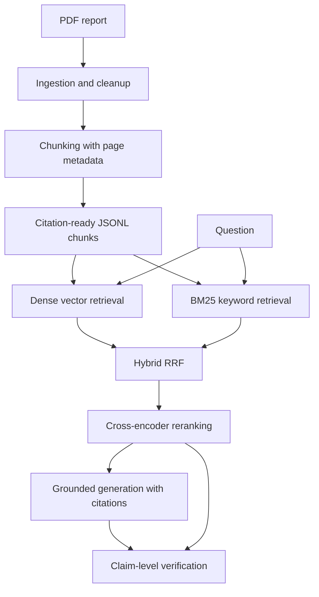

# VeriRAG

VeriRAG is a compact, citation-aware retrieval-augmented generation (RAG) project for PDF reports. It turns PDFs into page-traceable chunks, retrieves evidence with dense and keyword search, produces grounded answers with source citations, and verifies answer claims against the supplied evidence.

## Capabilities

- PDF extraction, text cleanup, sentence-aware chunking, and page metadata preservation.
- Persisted dense vector index, BM25 keyword retrieval, and reciprocal-rank fusion (RRF).
- Cross-encoder reranking of hybrid retrieval candidates.
- Grounded generation that instructs the model to answer only from retrieved context and appends source citations.
- Claim-level `supported`, `unsupported`, or `uncertain` verification. Unsupported requires direct contradictory evidence; missing evidence remains uncertain.



## Setup

The project declares Python `>=3.10`; the commands below target Python 3.11 on Windows PowerShell.

```powershell
py -3.11 -m venv .venv
.\.venv\Scripts\Activate.ps1
python -m pip install --upgrade pip
python -m pip install "PyMuPDF>=1.24,<2" "numpy>=1.26,<3" "sentence-transformers>=3,<6" "rank-bm25>=0.2,<1" "openai>=1,<3" "pytest>=8,<9"
```

Generation and most natural-language claim verification need an LLM. The code supports an Ollama provider at `http://localhost:11434/api/generate` and defaults to `llama3.2:3b` when configured for Ollama. Install Ollama using its [official download instructions](https://ollama.com/download), then pull and serve the default model:

```powershell
ollama pull llama3.2:3b
ollama serve
```

In a separate PowerShell session, configure VeriRAG for Ollama:

```powershell
$env:VERIRAG_LLM_PROVIDER = "ollama"
$env:VERIRAG_LLM_MODEL = "llama3.2:3b"
# Optional when Ollama is not at the default endpoint:
# $env:VERIRAG_OLLAMA_URL = "http://localhost:11434/api/generate"
```

## Run

Run the full test suite:

```powershell
python -m pytest -v
```

Run the compact retrieval benchmark against the committed Apple annual-report index:

```powershell
python evaluation/benchmark.py
```

To ingest a PDF into citation-ready JSONL chunks:

```powershell
python -m ingestion.pipeline path\to\report.pdf --output data\report.chunks.jsonl
```

The repository does not provide a single end-to-end question-answering CLI; retrieval, generation, and verification are exposed as Python modules/functions.

## Phase 7 benchmark

Latest measured results use 17 answerable draft questions from the committed Apple annual-report corpus, after embedding and cross-encoder model warm-up:

| Method | Recall@5 | MRR@5 | Mean latency | p95 latency |
| --- | ---: | ---: | ---: | ---: |
| Dense | 0.765 | 0.514 | 13.1 ms | 30.5 ms |
| BM25 | 0.824 | 0.529 | 0.3 ms | 0.5 ms |
| Hybrid RRF | 0.941 | 0.610 | 14.3 ms | 17.6 ms |
| Hybrid + reranking | 0.824 | 0.711 | 925.3 ms | 976.1 ms |

- **Recall@5**: share of questions with at least one labeled relevant chunk in the first five results.
- **MRR@5**: mean reciprocal rank of the first labeled relevant chunk, with zero when none appears in the first five.
- **Latency**: per-query wall-clock retrieval time after model warm-up; reranked latency includes cross-encoder inference.

## Project structure

```text
data/          Apple annual-report PDF, chunks, and persisted vector index
ingestion/     PDF loading, cleaning, chunking, and ingestion CLI
retrieval/     dense search, BM25, RRF hybrid search, and reranking
generation.py  grounded answer generation and LLM provider configuration
verification.py claim-level evidence verification
evaluation/    draft datasets, benchmark, and evaluation notes
tests/         unit and pipeline tests
```

## Current limitations

- Evaluation covers one Apple annual report only; it is a regression signal, not a broad QA benchmark.
- Retrieval and verification labels are drafts requiring human review.
- Verification precision, recall, and F1 are not automated because most verifier outcomes depend on the selected LLM and prompt behavior.
- Benchmark latency is machine- and model-cache-dependent. Reranking improves MRR in the current run but adds substantial CPU latency and can displace a relevant chunk from the final top five.

